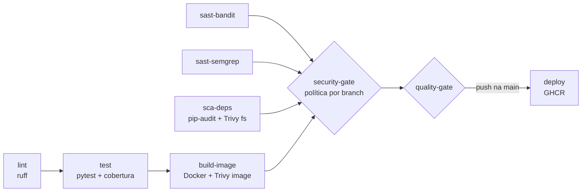

# cicd

API Flask de exemplo com uma esteira **CI/CD no GitHub Actions** que inclui análise **SAST**, **SCA** e **portões de qualidade (quality gates)** que bloqueiam o merge/deploy.

## Esteira



| Job | Ferramenta | Tipo | Bloqueia se... |
|-----|-----------|------|----------------|
| `lint` | ruff | Qualidade | houver erro de lint ou arquivo fora do padrão de formatação |
| `test` | pytest + pytest-cov | Qualidade | algum teste falhar ou a cobertura for < **80%** |
| `sast-bandit` | Bandit | SAST | só gera relatório (falha apenas em erro da ferramenta) |
| `sast-semgrep` | Semgrep (`p/python`, `p/flask`, `p/secrets`) | SAST | só gera relatório |
| `sca-deps` | pip-audit + Trivy (fs) | SCA | só gera relatório |
| `build-image` | Docker + Trivy (image) | SCA | o build falhar (o scan só gera relatório) |
| `security-gate` | `scripts/security_gate.py` | Política | a política de vulnerabilidades da branch for violada (veja abaixo) |
| `quality-gate` | — | Agregador | qualquer job acima não terminar com `success` |
| `deploy` | GHCR | CD | roda só em `push` na `main` após o quality gate, no environment `production` |

Todos os relatórios SAST/SCA são enviados em formato SARIF para **Security → Code scanning** do repositório.
Nenhuma ferramenta exige token ou conta externa.

### Política de vulnerabilidades (security-gate)

O job `security-gate` lê os relatórios JSON de todos os scanners e decide com base na **branch de destino**
(branch base no PR; branch atual em push):

| Branch | Modo | Bloqueia quando | Abaixo do limite |
|--------|------|-----------------|------------------|
| `main` | `threshold` | soma de achados **CRITICAL** (SAST + SCA) **≥ 3** | HIGH e 1–2 CRITICAL viram **aviso** no resumo |
| `test` e demais | `strict` | qualquer achado HIGH/CRITICAL ou vulnerabilidade do pip-audit | — |

Severidade considerada **CRITICAL** na contagem:

| Ferramenta | Conta como CRITICAL |
|------------|---------------------|
| Bandit | severidade HIGH com confiança ≥ MEDIUM (maior nível do Bandit) |
| Semgrep | severidade ERROR (maior nível do Semgrep) |
| Trivy (fs e imagem) | CVE ou segredo com severidade CRITICAL e correção disponível; a mesma CVE no mesmo pacote conta uma vez |
| pip-audit | não informa severidade: aviso na `main`, bloqueio na `test` |

O limite fica na variável `CRITICAL_THRESHOLD` no topo de `.github/workflows/ci.yml`.
Se algum relatório estiver ausente ou inválido, o gate **falha** (fail closed).

### Fluxo de branches

| Branch | Papel | O que roda |
|--------|-------|------------|
| `feature/*` | Desenvolvimento | nada (até abrir PR) |
| `test` | Integração / homologação | todos os gates em PR e push, **sem deploy** |
| `main` | Produção | todos os gates + **deploy** no GHCR |

Fluxo: `feature/*` → PR para `test` → PR de `test` para `main` → deploy.

### Proteção de branch

Em **Settings → Branches → Branch protection rules**, crie uma regra para `main` e outra para `test`:
1. Marque *Require a pull request before merging*.
2. Marque *Require status checks to pass before merging*.
3. Adicione o check **`Quality Gate`** como obrigatório.

Opcional: em **Settings → Environments → production**, adicione *Required reviewers* para aprovação manual antes do deploy.

## API

| Método | Rota | Descrição |
|--------|------|-----------|
| GET | `/health` | Health check |
| GET | `/api/tasks` | Lista tarefas |
| POST | `/api/tasks` | Cria tarefa (`{"title": "...", "done": false}`) |
| GET | `/api/tasks/<id>` | Busca tarefa |
| PUT | `/api/tasks/<id>` | Atualiza tarefa |
| DELETE | `/api/tasks/<id>` | Remove tarefa |

## Rodando localmente os mesmos checks

```bash
python -m venv .venv && source .venv/bin/activate
pip install -r requirements-dev.txt

ruff check . && ruff format --check .
pytest --cov --cov-fail-under=80
bandit -c pyproject.toml -r app scripts --severity-level high --confidence-level medium
pip-audit -r requirements.txt --strict

# Avaliar a política localmente a partir de uma pasta com os 5 relatórios JSON
# (bandit.json, semgrep.json, pip-audit.json, trivy-fs.json, trivy-image.json)
python scripts/security_gate.py --reports-dir reports --target-branch main

# Semgrep e Trivy via Docker
docker run --rm -v "$PWD:/src" -w /src semgrep/semgrep \
  semgrep scan --config p/python --config p/flask --config p/secrets --severity ERROR --error
docker build -t cicd-demo .
docker run --rm -v /var/run/docker.sock:/var/run/docker.sock aquasec/trivy \
  image --severity HIGH,CRITICAL --ignore-unfixed --exit-code 1 cicd-demo
```

Rodar a API:

```bash
docker run --rm -p 8000:8000 cicd-demo
curl localhost:8000/health
```

## Testando um gate reprovando

Crie uma branch e adicione algo inseguro em `app/routes.py`, por exemplo:

```python
import subprocess

subprocess.call(request.args["cmd"], shell=True)
```

Abra um PR para `test`: o `security-gate` (modo estrito) falha e o `Quality Gate` fica vermelho.
Num PR para `main`, o merge só é bloqueado quando a soma de achados CRITICAL chega a 3; abaixo disso
os achados aparecem como aviso no resumo do job.
